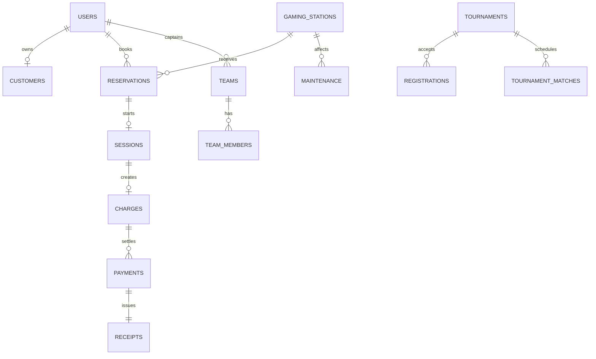

# GameHub database

GameHub uses SQLite with foreign keys enabled, a five-second busy timeout, and WAL journaling. The database is created at `%USERPROFILE%/.gamehub/gamehub.db`, or at `GAMEHUB_DB_PATH` when configured. `Database` applies the SQL migration at startup and closes the connection with the application.

The schema stores users and customer profiles, stations and reservations, sessions and charges, payments and receipts, membership plans, teams and approval requests, tournaments and matches, maintenance tickets, and audit events. Financial and historical rows are retained. Stations are deactivated by status and `active=0` instead of being deleted.

Reservation overlap uses half-open intervals. A conflict exists only when `existing.start < requested.end AND requested.start < existing.end`, so adjacent reservations are valid. Payment rows are append-only and charges move through `UNPAID`, `PARTIALLY_PAID`, and `PAID` inside the payment transaction.

All user-controlled values are bound parameters. Application writes use explicit commit and rollback boundaries for reservations, sessions, teams, and payment settlement.
